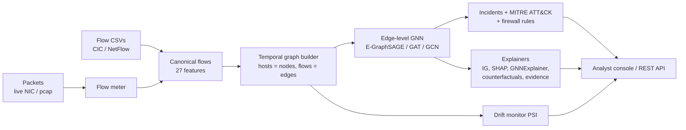

# XGNN-IDS: Explainable Graph Neural Network Intrusion Detection

[](https://github.com/sai-140307/XGNN-IDS/actions/workflows/ci.yml)


[](LICENSE)

Network traffic is turned into a graph every 20 seconds - **hosts are nodes, flows are edges** - and a graph
neural network classifies every flow as benign or one of seven attack families (DDoS, DoS, port scan,
brute force, botnet, web attack, infiltration). Every alert comes with an explanation an analyst can act on:
which properties of the flow mattered, which *other* flows in the network made it suspicious, what would
have had to change for it to look benign, and a suggested response.

*BCSE308P Computer Networks project, Vellore Institute of Technology - guided by Dr. Aaseegha M D (SCORE).
Team: Sai Chandra Reddy (24BYB0011), N Rishi Pranav (24BYB0082).*

<!-- RESULTS_START -->
<!-- RESULTS_END -->

## What it does

| Capability | Details |
|---|---|
| Graph-based detection | Directed temporal flow graphs; edge-level **E-GraphSAGE** (direction-aware), **GAT** (edge-feature attention), **GCN**; flow-only MLP, Random Forest and Gradient Boosting baselines |
| Explainability | **Integrated Gradients**, **SHAP**, **GNNExplainer** (which neighbouring flows matter), **counterfactuals** (what would make it benign), plain-language **network evidence** |
| Explanation quality, measured | Fidelity+, fidelity-, sparsity, stability and runtime for every explainer, against a random baseline |
| From alerts to action | **Incident correlation** (thousands of alerts → a few incidents), **MITRE ATT&CK** mapping, suggested **iptables / nftables** rules |
| Robustness | **Zero-day** leave-one-attack-out test, **adversarial** evasion (white-box PGD), **cross-domain** test on an unseen IoT network, **concept-drift** monitor (PSI) |
| Data sources | Built-in realistic traffic generator, CIC-IDS2017 / CSE-CIC-IDS2018 / CICDDoS2019, NF-* NetFlow datasets, pcap files, **live capture** |
| Interfaces | Streamlit analyst console with an **attack simulator** and live replay, REST API (FastAPI), command line, Docker |

## Architecture



Method details: [docs/ARCHITECTURE.md](docs/ARCHITECTURE.md). How each part answers a gap from the literature
review: [docs/LITERATURE_MAPPING.md](docs/LITERATURE_MAPPING.md).

## Quick start

```bash
git clone https://github.com/sai-140307/XGNN-IDS.git && cd XGNN-IDS
python -m venv .venv && source .venv/bin/activate        # Windows: .venv\Scripts\activate
pip install -r requirements.txt

streamlit run app/streamlit_app.py      # analyst console (trained models are included in models/)
```

Command line:

```bash
python -m xgnn_ids train                       # full experiment -> models/ and results/RESULTS.md
python -m xgnn_ids train --quick               # ~3 minute version
python -m xgnn_ids train --data day1.csv day2.csv   # real CIC / NetFlow CSVs (see docs/DATASETS.md)
python -m xgnn_ids detect capture.pcap         # alerts.csv + incidents.json
python -m xgnn_ids explain flows.csv           # explain the most confident alert
sudo python -m xgnn_ids live --iface eth0      # live sensor
uvicorn api.main:app --port 8000               # REST API, docs at /docs
pytest                                         # 57 tests
```

## Project layout

```
xgnn_ids/
  data/        synthetic traffic generator, dataset loaders, feature engineering
  graph/       temporal graph construction, chronological split
  models/      GCN, GAT, E-GraphSAGE, Flow-MLP (plain PyTorch)
  training/    training loop, baselines, metrics, robustness experiments, report
  explain/     IG, SHAP, GNNExplainer, counterfactuals, evidence, quality metrics
  analysis/    incident correlation, firewall rules, drift monitor
  capture/     flow meter, pcap reader, live sniffer
  inference.py Detector API used by the app, API and CLI
app/           Streamlit analyst console
api/           FastAPI service
tests/         pytest suite (models, explainers, loaders, API, dashboard)
docs/          architecture, datasets, deployment, lab demo, viva notes
results/       metrics, figures and example explanations from the last training run
models/        trained weights + preprocessing artifacts
```

## Documentation

- [Architecture and method](docs/ARCHITECTURE.md)
- [Using real datasets](docs/DATASETS.md) (CIC-IDS2017, CICDDoS2019, NetFlow)
- [Deployment](docs/DEPLOYMENT.md) (Streamlit Cloud, Docker, API)
- [Live lab demonstration](docs/LAB_DEMO.md)
- [Viva preparation](docs/VIVA.md)

## References

1. Zhong, M. et al. (2024). A Survey on Graph Neural Networks for Intrusion Detection Systems: Methods, Trends and Challenges.
2. Azeez, S. D., Ilyas, M., Ahmed, S. R. (2026). Graph Neural Networks with Multi-Head Attention and SHAP-Based Explainability for Robust, Interpretable, and High-Throughput Intrusion Detection in 5G-Enabled Software Defined Networks. https://doi.org/10.32604/cmc.2026.074930
3. Xu, R. et al. (2024). Applying Self-supervised Learning to Network Intrusion Detection for Network Flows with Graph Neural Network. https://arxiv.org/abs/2403.01501
4. Baahmed, M., Benaddi, F., Bouhorma, M. (2025). Using Graph Neural Networks for the Detection and Explanation of Network Intrusions. https://hal.science/hal-04909504
5. Khan, M. A., Alhazmi, F., Alhazmi, A. (2024). X-CBA: Explainability Aided CatBoosted Anomal-E for Intrusion Detection System. https://arxiv.org/abs/2402.00839
6. Mohammad, U. G. et al. (2026). An optimized graph neural network approach for robust and explainable IoT intrusion detection against adversarial attacks. https://doi.org/10.1038/s41598-026-48715-9
7. Wang, Y. et al. (2025). FedSTGCN: a novel federated spatiotemporal graph learning-based network intrusion detection method for the Internet of Things. https://doi.org/10.1631/FITEE.2400932
8. Graph-based federated learning approach for intrusion detection in IoT networks (2025). https://doi.org/10.1038/s41598-025-25175-1
9. Luša, R., Pintar, D., Vranić, M. (2025). TE-G-SAGE: Explainable Edge-Aware Graph Neural Networks for Network Intrusion Detection. https://www.mdpi.com/2673-3951/6/4/165

Methods implemented from: Lo et al. (2022) E-GraphSAGE; Ying et al. (2019) GNNExplainer; Sundararajan et al.
(2017) Integrated Gradients; Lundberg & Lee (2017) SHAP; Brody et al. (2022) GATv2; Kipf & Welling (2017) GCN;
Madry et al. (2018) PGD.

## License

MIT
