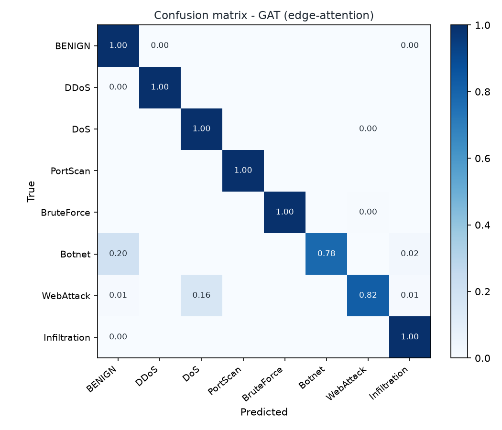
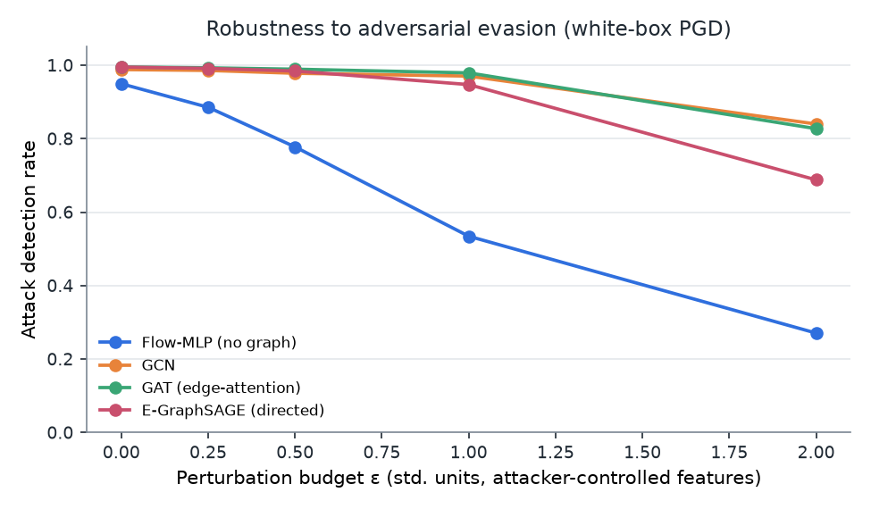
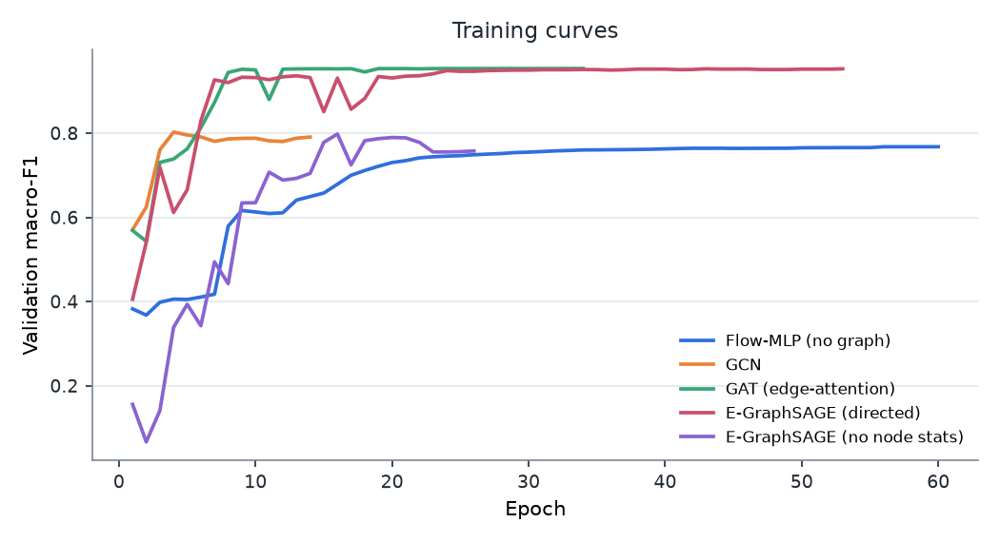

# Results

Data: **synthetic enterprise LAN (seed 0) + home Wi-Fi network (seed 1)** - 111,261 flows in 150 graph windows (20s each). Chronological split: train 58,694 / val 24,952 / test 27,615 flows.

Environment: Python 3.11.17, PyTorch 2.14.1+cpu, CPU (2 threads). Total run time 14.9 min.

## 1. Detection performance (test split)

| Model | Accuracy | Macro-F1 | Weighted-F1 | DDoS F1 | FPR | Detection rate | Latency ms/window | Flows/s |
|---|---|---|---|---|---|---|---|---|
| Flow-MLP (no graph) | 0.8959 | 0.7862 | 0.8912 | 0.8826 | 0.0469 | 0.9494 | 0.2 | 4,241,132 |
| GCN | 0.9725 | 0.7810 | 0.9660 | 0.9982 | 0.0182 | 0.9881 | 1.1 | 808,260 |
| GAT (edge-attention) **(default)** | 0.9933 | 0.9674 | 0.9931 | 0.9980 | 0.0026 | 0.9952 | 2.2 | 410,055 |
| E-GraphSAGE (directed) | 0.9944 | 0.9696 | 0.9942 | 0.9979 | 0.0005 | 0.9949 | 1.7 | 540,010 |
| E-GraphSAGE (no node stats) | 0.9651 | 0.8503 | 0.9641 | 0.9863 | 0.0104 | 0.9918 | 1.7 | 542,873 |
| Random Forest (flow features) | 0.9371 | 0.9241 | 0.9374 | 0.9221 | 0.0378 | 0.9726 | 28.9 | 31,797 |
| Random Forest + graph statistics | 0.9965 | 0.9768 | 0.9964 | 0.9992 | 0.0006 | 0.9966 | 16.5 | 55,918 |
| Gradient Boosting (flow features) | 0.9337 | 0.9212 | 0.9352 | 0.9207 | 0.0570 | 0.9835 | 10.1 | 91,016 |

### Per-class results - GAT (edge-attention)

| Class | Precision | Recall | F1 | Support |
|---|---|---|---|---|
| BENIGN | 0.9922 | 0.9974 | 0.9948 | 10456 |
| DDoS | 0.9998 | 0.9962 | 0.9980 | 8948 |
| DoS | 0.9820 | 0.9981 | 0.9900 | 3179 |
| PortScan | 1.0000 | 1.0000 | 1.0000 | 1779 |
| BruteForce | 1.0000 | 0.9954 | 0.9977 | 431 |
| Botnet | 1.0000 | 0.7783 | 0.8753 | 212 |
| WebAttack | 0.9739 | 0.8214 | 0.8912 | 364 |
| Infiltration | 0.9851 | 0.9987 | 0.9918 | 2246 |

## 2. Cross-domain generalisation (enterprise -> IoT, no retraining)

Benign-traffic drift (PSI vs. training): in-domain test 0.002, IoT network 0.686 (>0.25 = significant drift).

| Model | In-domain macro-F1 | IoT macro-F1 | IoT DDoS F1 | IoT FPR | IoT detection rate |
|---|---|---|---|---|---|
| Flow-MLP (no graph) | 0.7862 | 0.5822 | 0.8943 | 0.7556 | 0.9603 |
| GCN | 0.7810 | 0.6592 | 0.9809 | 0.6483 | 0.9996 |
| GAT (edge-attention) | 0.9674 | 0.7951 | 0.9999 | 0.6818 | 1.0000 |
| E-GraphSAGE (directed) | 0.9696 | 0.7952 | 0.9479 | 0.6603 | 0.9995 |
| E-GraphSAGE (no node stats) | 0.8503 | 0.6093 | 0.8919 | 0.7643 | 0.9951 |
| Random Forest (flow features) | 0.9241 | 0.7818 | 0.9238 | 0.4006 | 0.9787 |
| Random Forest + graph statistics | 0.9768 | 0.9408 | 0.9976 | 0.0001 | 0.9796 |
| Gradient Boosting (flow features) | 0.9212 | 0.7448 | 0.9264 | 0.5938 | 0.9832 |

### Few-shot adaptation to the new network

Fine-tuned on the first 7,762 IoT flows (12 windows, about 4 min of labelled traffic) plus a replay sample of the original training windows; evaluated on the last 28,063 IoT flows.

| Model | IoT macro-F1 before | IoT FPR before | IoT macro-F1 after | IoT FPR after | Enterprise macro-F1 after |
|---|---|---|---|---|---|
| GAT (edge-attention) | 0.8027 | 0.6783 | 0.9408 | 0.0147 | 0.9153 |
| Flow-MLP (no graph) | 0.5732 | 0.7547 | 0.7451 | 0.1032 | 0.7302 |
| Random Forest + graph statistics | 0.9197 | 0.0001 | 0.9128 | 0.0001 | 0.9774 |

## 3. Zero-day test (leave-one-attack-out)

Model: GAT (edge-attention). The hidden family is present in the training traffic but never labelled. *Detected* = classified as any attack or flagged as uncertain.

| Unseen family | Test flows | Flagged as attack | Uncertain | Detected (either) | Most common label | Benign false alarms |
|---|---|---|---|---|---|---|
| DDoS | 8,948 | 0.015 | 0.346 | 0.346 | BENIGN | 0.010 |
| DoS | 3,179 | 1.000 | 0.454 | 1.000 | WebAttack | 0.085 |
| PortScan | 1,779 | 1.000 | 0.368 | 1.000 | Infiltration | 0.018 |
| BruteForce | 431 | 0.868 | 1.000 | 1.000 | WebAttack | 0.009 |
| Botnet | 212 | 0.024 | 0.014 | 0.024 | BENIGN | 0.013 |
| WebAttack | 364 | 0.940 | 0.813 | 0.989 | DoS | 0.073 |
| Infiltration | 2,246 | 0.683 | 0.476 | 0.889 | PortScan | 0.012 |

## 4. Adversarial robustness

White-box PGD (10 steps) on attacker-controllable features (timing, volume, packet sizes); ε in standard deviations. Values = share of attack flows still detected.

| Model | ε=0.0 | ε=0.25 | ε=0.5 | ε=1.0 | ε=2.0 |
|---|---|---|---|---|---|
| Flow-MLP (no graph) | 0.949 | 0.885 | 0.777 | 0.534 | 0.271 |
| GCN | 0.988 | 0.986 | 0.978 | 0.970 | 0.840 |
| GAT (edge-attention) | 0.995 | 0.993 | 0.989 | 0.979 | 0.827 |
| E-GraphSAGE (directed) | 0.995 | 0.991 | 0.984 | 0.947 | 0.688 |

## 5. Explanation quality

56 correctly detected attack flows. Feature explainers rank the 5 most important items of the explanation space (27 flow features + 11 statistics of each endpoint host). Fidelity is measured in log-odds of the explained class: Fidelity+ = drop when the top items are reset to the training mean (higher = they are necessary), Fidelity- = drop when *only* they are kept (lower = they are sufficient). Flip rate = share of alerts whose class changes when the top items are reset. Sparsity = share of items not needed for 80% of the attribution mass. Stability = top-k overlap (Jaccard) under small input noise.

### Feature attribution

| Method | Fidelity+ (log-odds) | Fidelity- (log-odds) | Flip rate | Sparsity | Stability | Runtime ms |
|---|---|---|---|---|---|---|
| Integrated Gradients | 7.199 | 1.410 | 0.57 | 0.806 | 0.923 | 197.0 |
| SHAP | 6.440 | 3.025 | 0.61 | 0.884 | 0.558 | 4468.4 |
| GNNExplainer (feature mask) | 5.298 | 3.226 | 0.30 | 0.468 | 0.918 | 890.4 |
| Random | 0.994 | 7.245 | 0.07 | 0.486 | 0.066 | 0.1 |

### Structural explanation (top 20% of neighbouring flows removed / kept)

| Method | Fidelity+ (log-odds) | Fidelity- (log-odds) | Sparsity | Stability | Runtime ms |
|---|---|---|---|---|---|
| Edge Integrated Gradients | 2.584 | 0.216 | 0.728 | 0.929 | 141.3 |
| GNNExplainer | 0.200 | 2.066 | 0.591 | 0.083 | 886.8 |
| Same-destination heuristic | 1.453 | 1.141 | nan | nan | 0.0 |
| Random | 0.107 | 1.986 | nan | nan | 0.0 |

Example narratives: [example_explanations.md](example_explanations.md)

## Training curves

